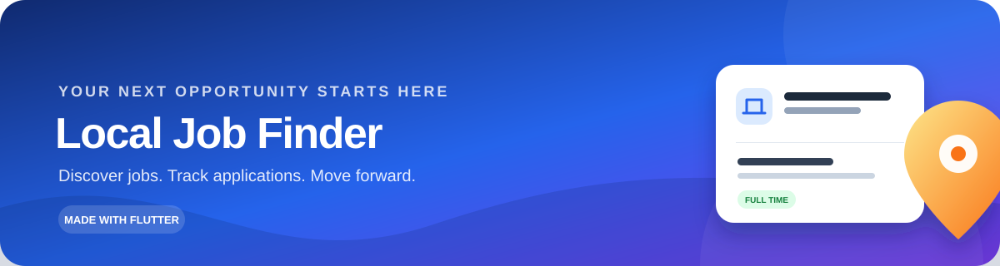
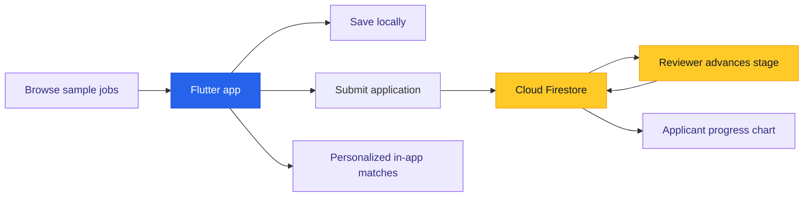

<div align="center">

<h1>💼 Local Job Finder</h1>



<h3>Find work that fits your skills, schedule, and location.</h3>


<br />

<strong>Explore opportunities · Save jobs · Apply · Follow your progress</strong>

</div>

---

## ✨ What you can do

| | Feature | How it helps |
|---|---|---|
| 🔎 | **Discover jobs** | Search listings and filter by category, work type, salary, and location. |
| 🌐 | **Explore MNC roles** | Browse a dedicated section featuring sample roles from 20 multinational companies. |
| 🔔 | **Personalize job matches** | Set preferred area, category, work type, and skills to find matching listings in the app. |
| 💾 | **Save jobs** | Keep a shortlist and come back to interesting opportunities later. |
| 📄 | **Check your resume** | Get a local ATS-style checklist and suggestions from a PDF resume. |
| 📬 | **Apply and follow progress** | Submit applications and view role-specific interview stages. |
| 🧭 | **Explore local hiring needs** | See common requirements in the listings and compare them with your skills. |

### 🏢 Companies in the MNC section

Google · Microsoft · Salesforce · Bloomberg · Amazon · Adobe · IBM · Oracle · Accenture · Deloitte · Tata Consultancy Services · Infosys · NVIDIA · Intel · Cisco · JPMorgan Chase · Goldman Sachs · Uber · Meta · Apple

---

## 🚀 Get started

### Requirements

- Flutter SDK with Dart **3.13 or newer**
- Xcode for iOS development
- Node.js **20** and Firebase CLI if you plan to deploy Cloud Functions

### Run the app

```bash
git clone https://github.com/Harshit18-19/Local_Job_Finder.git
cd Local_Job_Finder
flutter pub get
flutter run -d ios
```

To run the Flutter web build locally:

```bash
flutter run -d chrome
```

Firebase-backed features on web need a Firebase **Web app** configuration. The repository currently includes iOS Firebase configuration; web sign-in and Firestore need their own platform setup.

---

## 🔥 Firebase setup

The app can save a local application on the device when Firebase is unavailable. To enable shared application tracking and reviewer updates, connect a Firebase project:

1. Install and sign in to the Firebase tools:

   ```bash
   npm install -g firebase-tools
   dart pub global activate flutterfire_cli
   firebase login
   ```

2. Select your Firebase project for this checkout. If `.firebaserc` is not present, run:

   ```bash
   firebase use --add
   ```

3. Configure the platforms you will ship. For iOS:

   ```bash
   flutterfire configure --project YOUR_FIREBASE_PROJECT_ID --platforms ios
   ```

   Add `web` to `--platforms` when configuring browser support. The web app also needs Firebase initialization with the generated `DefaultFirebaseOptions.currentPlatform`; web options are not currently wired in this repository.

4. In Firebase Console, enable **Authentication → Sign-in method → Anonymous** and **Email/Password**. Create a **Cloud Firestore** database.

5. Deploy the repository’s Firestore rules and reviewer notification function:

   ```bash
   cd functions
   npm install
   cd ..
   firebase deploy --only firestore:rules,functions
   ```

   Cloud Functions deployment may require enabling billing for the Firebase project.

Firestore rules let applicants read their own applications and reserve interview-stage updates and decisions for reviewers. The Cloud Function writes a reviewer notification when a remote application is submitted.

### 👩‍💼 Reviewer access

Reviewer accounts need the `reviewer` custom claim. Set claims from a trusted Admin SDK environment, then have the reviewer sign out and back in so the refreshed token includes the role:

```js
await getAuth().setCustomUserClaims(USER_UID, { role: 'reviewer' });
```

Reviewers can advance pending applications through their interview stages or record an approval/rejection. The applicant’s Applied Jobs screen reads remote changes from Firestore.

---

## 🧩 How the pieces fit



---

## 🗂️ Project layout

```text
lib/
├── models/       # Jobs, applications, and resume evaluation data
├── screens/      # Job search, alerts, applications, and resume tools
├── services/     # Auth, applications, saved jobs, and resume checks
└── widgets/      # Reusable job cards and UI components
functions/        # Firebase Cloud Functions
firestore.rules   # Firestore access and reviewer permissions
docs/             # README artwork
```

---

## ℹ️ Sample data and current behavior

- **MNC roles are illustrative samples**, not verified live vacancies. Salary ranges are indicative; check each company’s careers site for current openings and compensation.
- **Job alerts are in-app matches** based on saved preferences. They do not send device push notifications.
- **Resume evaluation is a local checklist estimate**, not an employer ATS result or a hiring prediction.
- Applications are stored in Firestore when the backend is configured; otherwise, the app labels them as saved on the current device only.
- The current Google sign-in flow on web is not yet linked to a Firebase Auth session. Configure a Firebase Web app and complete the web provider integration before relying on it for backend access.

---

## 🛠️ Built with

Flutter · Dart · Firebase Authentication · Cloud Firestore · Firebase Cloud Functions · Shared Preferences · PDF text extraction

---

<div align="center">

**Built to make the next step in your job search a little easier.** 💙

</div>
